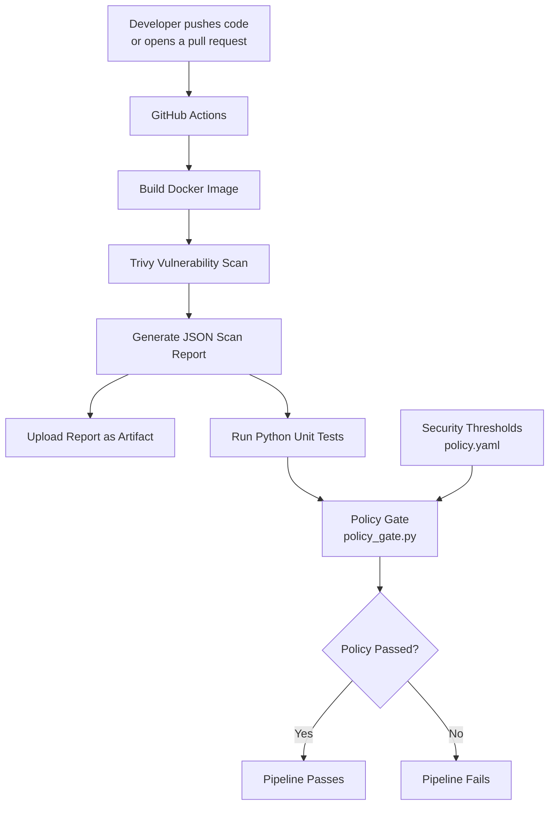

# Docker Image Security Scanning & Vulnerability Management

[](https://github.com/mubashir251-tech/docker-image-security-lab/actions/workflows/security-scan.yml)

A hands-on container security project demonstrating vulnerability scanning, security reporting, policy enforcement, and CI integration using **Trivy, Grype, Docker, Python, and GitHub Actions**.

## Overview

Container images can contain vulnerable operating-system packages and application dependencies. This project implements a repeatable workflow to identify vulnerabilities, compare scanner results, generate reports, and enforce security thresholds before an image proceeds through CI.

## Architecture

The pipeline builds a Docker image, scans it for vulnerabilities, runs automated policy tests, and enforces security thresholds through GitHub Actions.



### Pipeline stages

1. **Build:** Build the Docker image from the repository's Dockerfile.
2. **Scan:** Trivy identifies known vulnerabilities and generates a JSON report.
3. **Report:** Upload the scan report as a GitHub Actions artifact.
4. **Test:** Run automated tests against the policy-gate logic.
5. **Enforce:** Compare vulnerability counts against the thresholds in `policy.yaml`.
6. **Decide:** Pass or fail the workflow based on the configured security policy.

**Note:** Grype is used for the lab's broader image-comparison scans; the current GitHub Actions workflow uses Trivy for its automated image scan.

## Technology Stack

| Technology | Purpose |
|---|---|
| Docker | Build container images |
| Trivy | Scan images for vulnerabilities |
| Grype | Independent vulnerability scanning |
| Python and PyYAML | Parse and enforce security policy |
| jq | Validate JSON and summarize findings |
| Bash | Automate scanning and reporting |
| GitHub Actions | Run security checks in CI |

## Features

- Scan multiple container images with two vulnerability scanners.
- Generate JSON reports for each scanner.
- Validate report files before accepting them.
- Produce a Markdown summary of Critical, High, Medium, and Low findings.
- Configure vulnerability thresholds in YAML.
- Return a nonzero exit code when the policy fails.
- Run image scanning and policy enforcement in GitHub Actions.
- Exclude generated JSON reports and secrets from version control.

## Project Structure

```text
docker-image-security-lab/
├── .github/
│   └── workflows/
│       └── security-scan.yml
├── .dockerignore
├── .gitignore
├── Dockerfile
├── images.txt
├── policy.yaml
├── policy_gate.py
├── scan_images.sh
├── summarize_reports.sh
├── reports/
│   └── summary.md
└── tests/
    └── test_policy_gate.py
```

The test file will be added in the next implementation step.

## Prerequisites

- Linux environment or Ubuntu EC2 instance
- Docker Engine
- Trivy
- Grype
- Python 3
- PyYAML
- jq
- Git

## Run the Lab

### 1. Build the test image

```bash
docker build -t lab-security-image:local .
```

### 2. Scan the configured images

```bash
./scan_images.sh images.txt reports
```

### 3. Generate the Markdown summary

```bash
./summarize_reports.sh
cat reports/summary.md
```

### 4. Enforce the security policy

```bash
python3 policy_gate.py \
  reports/ubuntu-22.04-trivy.json \
  policy.yaml
```

The policy gate returns exit code `0` for PASS, `1` for a policy failure, and `2` for invalid input or configuration.

## Policy Configuration

Example `policy.yaml`:

```yaml
fail_on:
  critical_count_exceeds: 0
  high_count_exceeds: 10

warn_on:
  medium_count_exceeds: 50

report_label: "Lab 34 Docker Image Security"
```

With this configuration:

- Any Critical finding causes a failure.
- More than 10 High findings causes a failure.
- More than 50 Medium findings triggers a warning.
- Low findings are reported but do not determine the verdict.

These are demonstration thresholds. A production policy should reflect the organization's risk tolerance, exploitability, exposure, and remediation requirements.

## Sample Results

Recorded Trivy results from the initial lab scans on October 15, 2026:

| Image | Critical | High | Medium | Low |
|---|---:|---:|---:|---:|
| `node:18-alpine` | 3 | 41 | 52 | 38 |
| `node:18` | 227 | 2,051 | 6,632 | 2,438 |
| `ubuntu:18.04` | 0 | 0 | 0 | 0 |
| `ubuntu:22.04` | 0 | 1 | 14 | 21 |

These are recorded results, not guaranteed current counts. Vulnerability databases, image tags, and severity mappings change over time.

Trivy and Grype may report different results because their vulnerability data, package matching, and severity mappings differ. A zero count is not proof that an image is secure. Ubuntu 18.04 is end-of-life, so its zero Trivy result must not be interpreted as evidence of safety.

## CI Workflow

The GitHub Actions workflow:

1. Checks out the repository.
2. Builds the Docker test image.
3. Scans the image with Trivy.
4. Uploads the JSON report as an artifact.
5. Installs the Python policy dependency.
6. Enforces the configured policy.

A policy violation should fail the job. A successful workflow means the configured checks passed; it does not guarantee that the image is vulnerability-free.

## Security Considerations

- Keep access tokens and other secrets out of source control.
- Review scanner findings before accepting an image.
- Prefer supported base-image versions and rebuild images regularly.
- Pin actions and dependencies according to your organization's supply-chain security requirements.
- Review false positives, unfixed findings, and severity differences between scanners.
- Retain reports as CI artifacts rather than committing large generated JSON files.

## Learning Outcomes

This project demonstrates practical experience with:

- Container image vulnerability management
- Multi-scanner security assessment
- Bash automation and JSON processing
- YAML-based policy enforcement
- CI security gates and exit-code handling
- Security reporting and remediation prioritization

## Future Improvements

- Automated unit tests for the policy gate
- CI tests covering both policy pass and policy failure
- SARIF integration for GitHub code scanning
- Image digest pinning and dependency updates
- Vulnerability trend reporting across builds
- Screenshots of successful CI runs and generated reports

## Author

**mubashir251-tech**

GitHub: [github.com/mubashir251-tech](https://github.com/mubashir251-tech)

Project: [docker-image-security-lab](https://github.com/mubashir251-tech/docker-image-security-lab)
